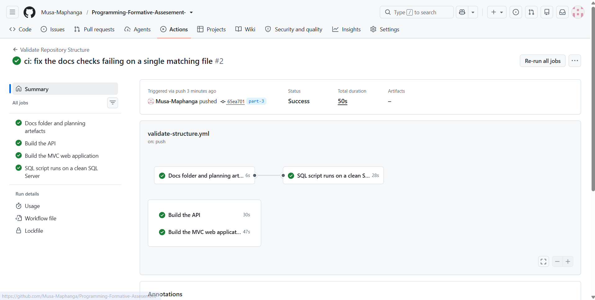

# RaceDay

RaceDay is an event management system for road running, walking and cycling events in
South Africa. Organisers can set up events and capture results, and participants can
enter events and keep track of how they did.

This repository holds all three parts: the planning and database, the API, and the MVC
web front end.


---

## What is in here

```
.
├── docs/                        Part 1 planning
│   ├── RaceDay_ERD.png          The ERD
│   ├── RaceDay_Schema.sql       The database script
│   ├── API_Endpoint_Plan.md     Every endpoint, updated to match the finished API
│   ├── Part1_README_original.md The Part 1 write-up
│   └── migrations/              Hand-run SQL for schema changes made after Part 1
├── src/RaceDay.Api/             Part 2: the REST API (ASP.NET Core 8, EF Core, SQL Server)
├── part3/                       Part 3: the MVC web front end
│   ├── RaceDay.Web/
│   └── Dockerfile
└── .github/workflows/           CI: structure checks, SQL script, API build, MVC build, Docker
```

---

## Running it

The three pieces start in order: database, API, then the web front end.

### 1. Database

Open `docs/RaceDay_Schema.sql` in SSMS and run it, or let the API create the database
itself — it calls `Database.Migrate()` on startup.

If you already have a database from Part 1 or Part 2, run this once to add the two
columns Part 3 needs for images:

```bash
cd src/RaceDay.Api
dotnet ef migrations add AddImageUrls
dotnet ef database update
```

`docs/migrations/AddImageUrls.sql` does the same thing by hand if you would rather not
use EF.

### 2. The API

```bash
cd src/RaceDay.Api
dotnet run
```

Swagger is at the root of whichever port it starts on. Log in with
`POST /api/auth/login`, click **Authorize**, and paste the token.

Image uploads need a storage account. Either put the connection string in
`appsettings.json` under `AzureStorage:ConnectionString`, or keep it out of source
control with an environment variable:

```bash
export AzureStorage__ConnectionString="<your storage connection string>"
```

Leave it empty and everything else still works; the two upload endpoints answer 503.

### 3. The web front end

```bash
cd part3
docker build -t raceday-web . && docker run -d -p 8080:8080 \
  -e RaceDayApi__BaseUrl=http://host.docker.internal:5001 \
  --name raceday-web raceday-web
```

Open <http://localhost:8080>. `RaceDayApi__BaseUrl` is where the API is listening;
`host.docker.internal` is how a container reaches a service on your own machine, since
`localhost` inside a container means the container itself.

Without Docker:

```bash
cd part3/RaceDay.Web
dotnet run
```

---

## Part 1 — planning and database

Seven tables: Roles, Users, EventTypes, Events, Categories, Enrolments and Results.
Participants and Events are many-to-many, and Enrolments is the table in the middle that
sorts that out. The full reasoning is in `docs/Part1_README_original.md`, and the design
decisions worth defending are:

- **Roles and event types are lookup tables**, so a typo like "Organizer" cannot get in
  and new event types do not need a schema change.
- **A category must belong to its event.** Categories has a unique constraint on
  `(CategoryId, EventId)` and Enrolments uses a composite foreign key on those two
  columns, so the database itself refuses a category from a different event.
- **One entry per participant per event**, enforced by a unique constraint.
- **One result per enrolment**, enforced by a unique constraint on `EnrolmentId`.

Part 3 added two columns to this schema: `Events.BannerImageUrl` and
`Users.ProfilePictureUrl`, both `NVARCHAR(500) NULL`. The images live in Azure; the
database only keeps the URL.

## Part 2 — the API

ASP.NET Core 8 with EF Core and SQL Server. JWT tokens that point at a server-side
session, so logging out genuinely ends the session rather than just dropping the token.
Roles are checked against the database, not only against the token, because a foreign key
cannot stop a Participant's id ending up in `Events.OrganiserId`.

Every endpoint is listed in `docs/API_Endpoint_Plan.md` and documented in Swagger.

## Part 3 — the MVC front end

An ASP.NET Core MVC application that consumes the Part 2 API for everything. It has no
`DbContext`, no SQL client package and no connection string: all of its data arrives as
JSON through one typed client, `IRaceDayApiClient`. CI fails the build if a reference to
Entity Framework, a SQL client, a connection string or an Azure SDK appears in that
project, so the rule is enforced rather than just intended.

The signed-in user lives in session: the JWT, the user id, the role and a display name.
Signing out clears it. A role filter guards the protected pages, sending anonymous
visitors to sign in with a return address, and sending a signed-in user who opens the
other role's pages to a page that explains why rather than to a login form they do not
need.

Organisers and participants get genuinely different applications:

| | Organiser | Participant |
|---|---|---|
| Lands on | Dashboard | Find a race |
| Menu | Dashboard, My events, Create an event | Find a race, My events, My results |
| Can | Create events, add categories, view entries, capture results | Browse and filter races, enter, withdraw, track results |

Banner images and profile pictures are posted to the API as `multipart/form-data`. The
API stores them in Azure Blob Storage and returns the URL. The MVC project holds no Azure
credentials.

### The look

The interface borrows from what a runner handles on race morning: dates set as bib tags
pinned to the event artwork, finish times in condensed tabular numerals like a finish
clock, and a striped rule under the masthead standing in for a timing mat.

Green, amber and red are reserved for status and used for nothing else, so colour always
means the same thing. That is why the brand colour is indigo — a green button would make
a green "Confirmed" badge meaningless. Every status badge also carries a dot and its
wording, so it still reads for anyone who cannot distinguish the colours.

---

## CI

`.github/workflows/validate-structure.yml` runs on every push and pull request:

1. **Structure** — `/docs` exists and holds the ERD, the endpoint plan and the SQL script.
2. **SQL** — the Part 1 script runs on a clean SQL Server 2022 container, twice, to prove
   it is re-runnable.
3. **API** — `src/RaceDay.Api` builds.
4. **MVC** — `part3` builds, contains no database or Azure access, and the Docker image
   builds and answers on `/health`.

### Successful build

<!-- Replace with your own screenshot: Actions tab -> latest green run -->


---

## Author

Musa Maphanga · ST10392587
